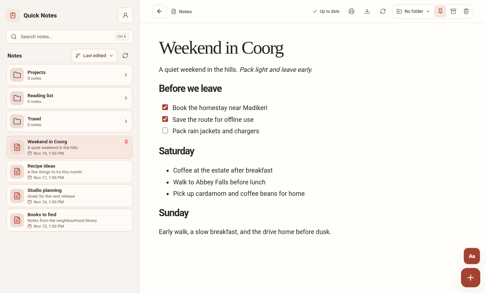
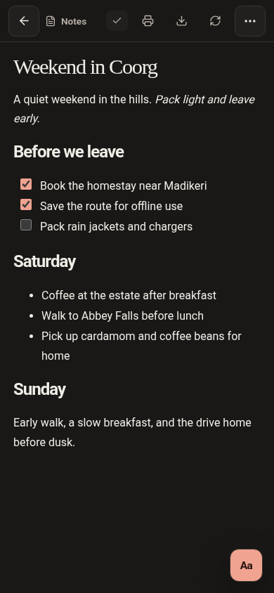

# Quick Notes

Quick Notes is a self-hosted, offline-capable notes app. Write in a rich-text editor, organize notes into folders, and pick up your work on another device when sync is available. Install it from a supported Chromium browser’s app menu, or use it in the browser.



## Features

- **Write and share.** Format headings, lists, checklists, links, tables, and code. Copy or paste Markdown from the editor’s context menu. Download a note as a PDF or print it.
- **Organize.** Group notes in folders, pin important notes, search synced notes, and archive finished work. Trash stays recoverable until you explicitly delete a note permanently.
- **Work offline.** The installed app can reopen locally saved drafts and recently cached notes. It saves edits on the device first and syncs them when the server is reachable.
- **Keep browsing during sync.** Lists and folders stay visible during background refresh. If two devices edit the same note, you can compare versions and keep your draft as a separate note.
- **Self-host.** Each account has its own notes and folders. The instance owner provisions accounts or approves requests through the signup waitlist.

<details>
<summary>Mobile screenshot</summary>



</details>

## Run locally

Requires Bun 1.4.4 and PostgreSQL 18. Docker Compose can provide PostgreSQL.

1. Run `bun install --frozen-lockfile` and copy `.env.example` to `.env`.
2. Generate a session secret with `openssl rand -hex 32` and set `BETTER_AUTH_SECRET` in `.env`. Set `POSTGRES_PASSWORD` and the corresponding password in `DATABASE_URL`. Use a URL-safe database password or encode it in the URL.
3. Run `docker compose up -d db`, then `bun run db:migrate`.
4. Provision a user from Bash. Enter a password of at least 8 characters when prompted.

   ```bash
   read -r -s -p 'Quick Notes password: ' quick_notes_password
   printf '\n'
   printf '%s\n' "$quick_notes_password" | bun run account:create you@example.com
   unset quick_notes_password
   ```

5. Run `bun run build` and `bun run start`, then open http://localhost:3000. Use the production build for service worker and offline checks.

For Vite development, run `APP_ORIGIN=http://localhost:5173 bun run start` alongside `bun run dev`, opening the Vite origin. The database is shared between development and the production build, so use a separate development database when needed.

## Host privately

Build static assets with `bun install --frozen-lockfile` and `bun run build`. Apply migrations and run `bun run start` from the project directory. Terminate TLS at a reverse proxy, keep Bun behind it, and set `APP_ORIGIN` to the external HTTPS origin. Quick Notes uses `APP_ORIGIN` for authentication and trusted-origin checks. Keep API routes and the shell on that origin. See [.env.example](.env.example) for the full configuration. Serve the worker and HTML with revalidation and retain prior hashed assets during a rollout. Use a TLS database URL for a remote database. If the reverse proxy overwrites a client-IP header, set `TRUSTED_CLIENT_IP_HEADER` to its name so login throttling can operate per client. With no header configured, login throttling uses a shared bucket. Set up database backups with a restore drill and restrict production credentials and provisioning access.

For password recovery, run `bun run account:reset-password you@example.com` and pass the new password via stdin as in the provisioning example. The reset revokes existing sessions. Use the provisioning command or approve a signup request to create an account.

## Approve signup requests

The sign-in page links to **Sign up**. The user chooses a password and receives a request ID. Confirm that the applicant sent you the matching request ID through a channel you trust before approving it. The app does not send verification or approval email.

Run these statements in the Quick Notes PostgreSQL database:

```sql
SELECT id, email, requested_at
FROM signup_waitlist
WHERE approved_at IS NULL
ORDER BY requested_at;

UPDATE signup_waitlist
SET approved_at = now()
WHERE id = '<request-id>' AND approved_at IS NULL
RETURNING id, email, approved_at;
```

Approval creates the account and clears the pending password hash in the same transaction. The applicant can then sign in with the password they chose. Remove rejected requests with `DELETE FROM signup_waitlist WHERE id = '<request-id>' AND approved_at IS NULL;`.

## Writing and recovery

The [Writing in Quick Notes guide](docs/writing-notes.md) covers the editor, Markdown shortcuts, and organizing notes. Open it from the pinned entry or the Account menu.

**Saved on device** means the local transaction completed. **Saved to server** means the server acknowledged the current draft. Drafts still pending when the browser profile is cleared or evicted are recoverable only from a prior download. One tab per account and browser profile edits at a time. Close the writable tab to hand off editing. Another device can edit concurrently and receives a conflict when its base revision is stale.

Choose **Create folder** from the create menu. Notes created while a folder is selected go into it automatically. Use **Move note to folder** to organize existing notes. Deleting a folder moves its notes to Trash immediately. Restored notes return without a folder. Folder membership is included in exports.

When a conflict appears, review the server text, then save your draft as a new note or explicitly replace the reviewed version. **Download drafts** includes data still in memory and locally committed changes. While signed in, open `/api/export` on your instance to download a versioned JSON backup of your server notes and folders. To restore a server export into a provisioned account, run `bun run backup:restore you@example.com backup.json`. This creates new note copies and retains formatting, archive, trash and pin states. Recovery JSON is readable and can also be used to recover a draft manually.

## Architecture

The web app uses Solid, Tiptap, TanStack Query, and IndexedDB. A Hono API runs on Bun and stores synced data in PostgreSQL. The architecture guide explains how the cache, drafts, and server revisions interact. [Architecture guide](docs/architecture.md)

## Verify

- `bun run lint`, `bun run format:check`, `bun run check` and `bun run build`. Use `bun run format` to apply formatting.
- `bun test` for the document contract. With a migrated disposable database and configured environment, run `QUICK_NOTES_INTEGRATION=1 bun test` for session and API tests.
- With the production server running against a disposable database, run `bun tests/browser.ts` for the Chromium PWA test. Set `CHROMIUM_BIN` if Chromium is installed elsewhere. Integration and browser tests create test accounts and notes. Run `bun tests/benchmark.ts` against that server for the Linux Chromium latency sample.

## License and credit

Quick Notes was created by Lakshmikanta Patra. The MIT License allows use, modification, and redistribution, including commercial use, as long as copies or substantial portions include the original copyright and permission notices. See [LICENSE](LICENSE).
